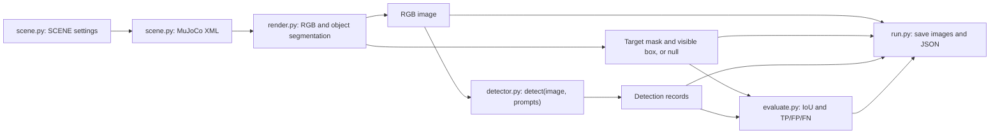

# Couch detection sandbox

One editable MuJoCo experiment: a couch on a plain floor, or the same view with the couch absent. The program renders an RGB image and segmentation mask, asks Grounding DINO Tiny for `couch`, and records detections plus IoU-based TP/FP/FN counts. It does not model a house or the physical Go2 camera.

Edit `SCENE` in `scene.py` for the existing couch, camera, and lighting settings. Adding a different mesh or scene geometry requires the small source changes described in [the scene guide](docs/SCENES.md).

## Architecture

This diagram is Mermaid source rendered by GitHub, not a generated image:



`run.py` calls the renderer, detector, and evaluator in that order. The detector sees only RGB pixels and prompts; it does not receive MuJoCo's segmentation or ground-truth box. Read [the scene and 3D model guide](docs/SCENES.md) for changing geometry and environments, and [the detector adapter guide](docs/DETECTORS.md) for DINO's implementation and another model's interface.

## Linux setup and one run

On Ubuntu, install the headless rendering libraries and Python dependencies:

```bash
sudo apt-get update
sudo apt-get install -y libgl1 libosmesa6
python3 -m venv .venv
source .venv/bin/activate
python -m pip install --upgrade pip
python -m pip install torch==2.6.0 --index-url https://download.pytorch.org/whl/cpu
python -m pip install -r requirements.txt
MUJOCO_GL=osmesa python -m pytest -q
MUJOCO_GL=osmesa python run.py --output output/present-normal
```

The first inference downloads the pinned Grounding DINO Tiny model. For a CUDA host with compatible PyTorch, install its CUDA build and add `--device cuda`.

To test an absent target, change `target_present = True` to `False` in `SCENE` in `scene.py`, then run with a new output name:

```bash
MUJOCO_GL=osmesa python run.py --output output/absent-normal
```

The command refuses to write into a nonempty output directory. Use a new name for every condition so the images and settings remain paired. `output/` is ignored by Git.

## Change the scene

`SCENE` exposes `target_present`, `couch_position`, `couch_yaw_deg`, and `lighting` (`normal`, `dim`, or `bright`). The camera has no presets: edit `camera_position`, `camera_look_at`, `width`, `height`, `fx`, `fy`, `cx`, and `cy` directly. Position and look-at are MuJoCo world coordinates in metres; the image dimensions and intrinsics are in pixels. These are synthetic values, not measured Go2 calibration.

Keep the `couch` prompt fixed while comparing present and absent images. Change one scene field at a time when testing why a detection changes. The floor and light remain in both scene states. The couch mesh is omitted entirely when `target_present` is false.

## Read the result

Each run writes `rgb.png`, `target_mask.png`, `annotated.png`, and `result.json`. The mask is white on visible couch pixels and black elsewhere; it is entirely black when the couch is absent. The annotated image shows the visible ground-truth box in cyan and qualifying predictions in green.

`result.json` records every scene field, the text prompt, ground truth (`present`, visible-pixel `bbox`, and `visible_pixels`), each prediction (`label`, `score`, pixel-space `bbox`, and `model_name`), model revision and thresholds, and the evaluation decision. A detection needs score at least 0.35 and IoU at least 0.50 with the visible couch box to count as a true positive. A missed couch is a false negative. Extra or misplaced qualifying boxes are false positives. When the couch is absent, `bbox` is `null` and every qualifying prediction is a false positive.

The program intentionally has no batch runner or aggregate report. Two output directories are enough to compare a small experiment; this single scene is not a detector performance estimate.

## Add another detector later

`detector.py` defines the shared `Detection(label, score, bbox, model_name)` record and `Detector` protocol. Another adapter should implement `detect(image, prompts)` and `metadata()`, return pixel-space xyxy boxes, and keep scores between zero and one. Change the detector construction in `run.py:main` to select it; the renderer, evaluator, and saved result format do not need to change. [The adapter guide](docs/DETECTORS.md) walks through DINO's implementation and a second adapter step by step. Grounding DINO is the only implemented adapter here.

The couch mesh comes from Quaternius's Ultimate House Interior Pack under CC0; see `assets/CC0-LICENSE.txt`.
